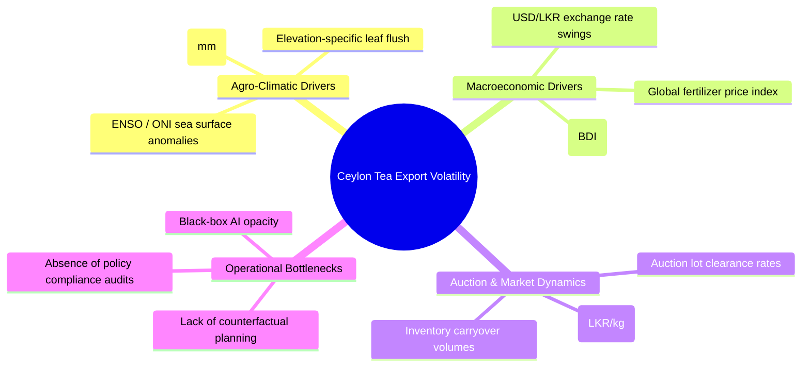
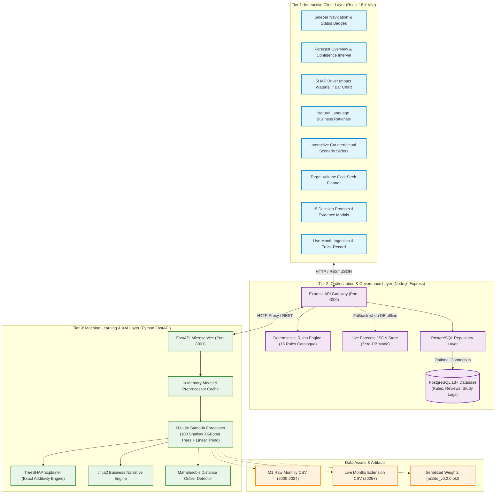
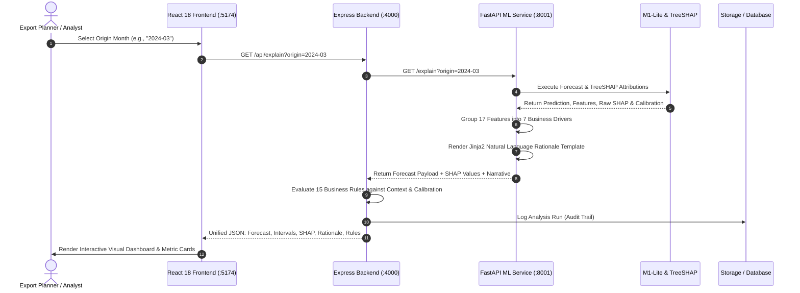
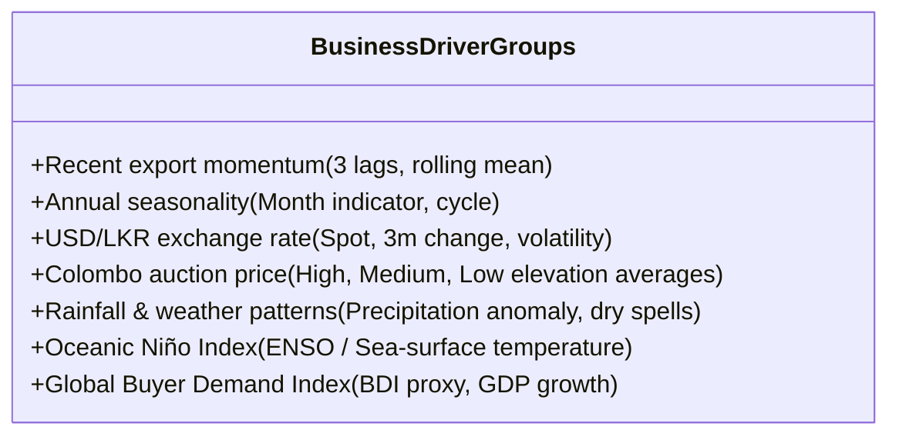
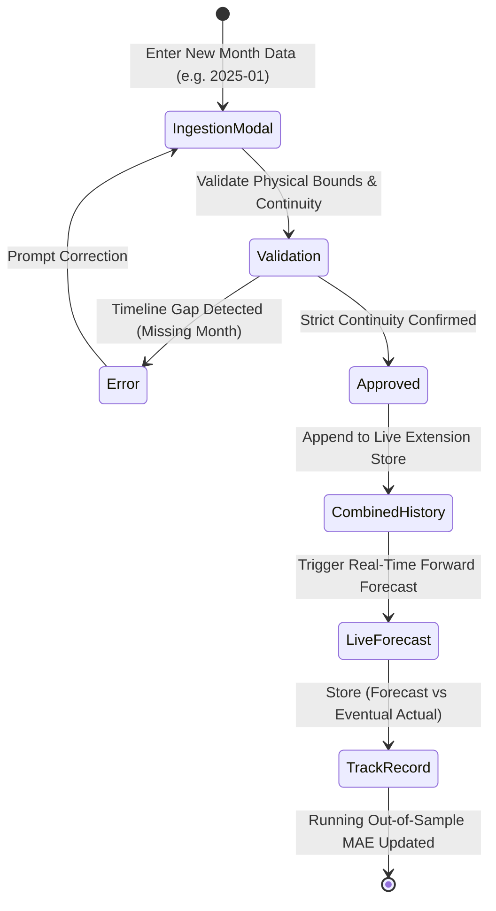
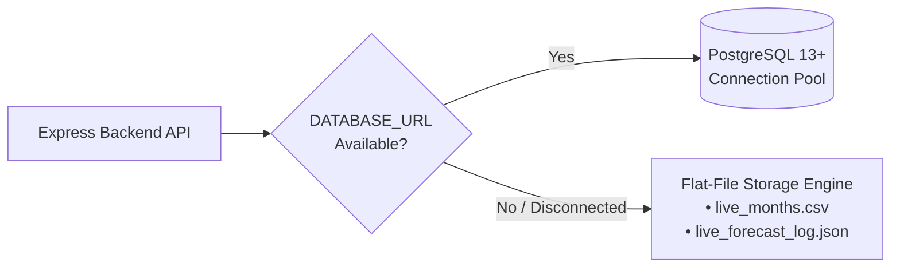
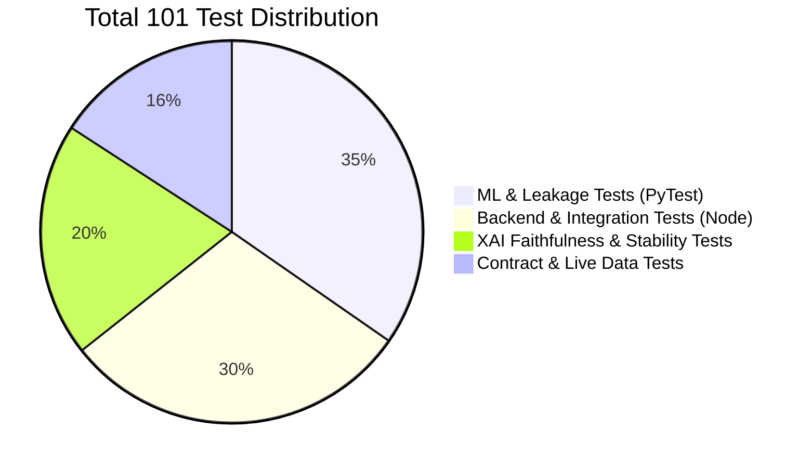
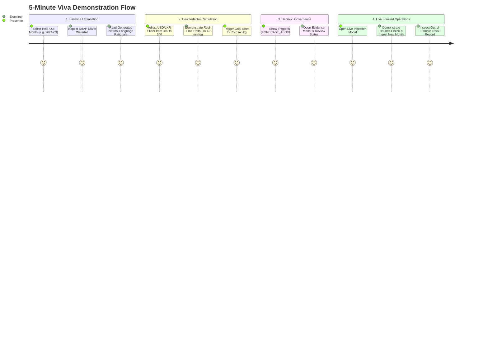

# AI-Based Decision Support System for Sri Lankan Tea Export Operations
### Component M3: Explainable AI (XAI) & Decision Support System

[](https://github.com/YasasLakmina/backdate-commit-test)
[](https://www.python.org/)
[](https://fastapi.tiangolo.com/)
[](https://xgboost.readthedocs.io/)
[](https://nodejs.org/)
[](https://expressjs.com/)
[](https://react.dev/)
[](https://vitejs.dev/)
[](https://www.postgresql.org/)
[](https://github.com/YasasLakmina/backdate-commit-test)

---

## Academic Context & Attribution

* **Institution:** Sri Lanka Institute of Information Technology (SLIIT)
* **Faculty:** Faculty of Computing / Department of Information Technology
* **Module:** IT4010 - Comprehensive Capstone Research Project (2026)
* **Project ID:** J26-IT-423
* **Lead Researcher / Student:** D S T W Dassanayake (IT23293076 / Yasas Lakmina)
* **Deliverable Component:** **Component M3: Explainable AI & Decision Support System**
* **Companion Subsystem:** **M1-lite Stand-in Forecaster** (High-fidelity, lag-safe XGBoost + Temporal blend forecaster)

---

## Table of Contents

- [1. Executive Summary](#1-executive-summary)
- [2. The Domain Challenge & Motivation](#2-the-domain-challenge--motivation)
- [3. End-to-End System Architecture](#3-end-to-end-system-architecture)
  - [3.1 High-Level 3-Tier Architecture](#31-high-level-3-tier-architecture)
  - [3.2 Data Flow & Inference Pipeline](#32-data-flow--inference-pipeline)
  - [3.3 Mathematical Formulation & SHAP Additivity](#33-mathematical-formulation--shap-additivity)
- [4. Core Subsystems & Innovations](#4-core-subsystems--innovations)
  - [4.1 Explainable AI Engine (TreeSHAP + 7 Driver Groups)](#41-explainable-ai-engine-treeshap--7-driver-groups)
  - [4.2 Natural Language Business Rationale](#42-natural-language-business-rationale)
  - [4.3 Counterfactual What-If Scenario Simulator](#43-counterfactual-what-if-scenario-simulator)
  - [4.4 Target Goal-Seek Optimizer](#44-target-goal-seek-optimizer)
  - [4.5 Business Decision Rules Catalogue (15 Rules)](#45-business-decision-rules-catalogue-15-rules)
  - [4.6 Continuous Live Operations & Model Track Record](#46-continuous-live-operations--model-track-record)
  - [4.7 Dual-Mode Persistence Architecture](#47-dual-mode-persistence-architecture)
- [5. Machine Learning Benchmarks & Evaluation](#5-machine-learning-benchmarks--evaluation)
  - [5.1 Dataset Specifications & Quality Assurance](#51-dataset-specifications--quality-assurance)
  - [5.2 Walk-Forward Expanding Window Evaluation](#52-walk-forward-expanding-window-evaluation)
  - [5.3 Explanation Faithfulness & Stability Metrics](#53-explanation-faithfulness--stability-metrics)
- [6. Repository File Structure](#6-repository-file-structure)
- [7. Installation & Quickstart](#7-installation--quickstart)
  - [7.1 One-Click Windows Setup (Recommended)](#71-one-click-windows-setup-recommended)
  - [7.2 Manual Multi-Service Setup](#72-manual-multi-service-setup)
- [8. REST API Reference](#8-rest-api-reference)
  - [8.1 ML Service (FastAPI - Port 8001)](#81-ml-service-fastapi---port-8001)
  - [8.2 Orchestration Backend (Express - Port 4000)](#82-orchestration-backend-express---port-4000)
- [9. Testing & Quality Assurance](#9-testing--quality-assurance)
- [10. Viva Presentation & Demonstration Walkthrough](#10-viva-presentation--demonstration-walkthrough)
- [11. Research Limitations & Governance](#11-research-limitations--governance)
- [12. License & Disclaimers](#12-license--disclaimers)

---

## 1. Executive Summary

The **AI-Based Decision Support System for Sri Lankan Tea Export Operations** (Component M3) transforms black-box machine learning predictions into **auditable, actionable, and transparent intelligence** for Colombo tea auction brokers, exporters, and government policy planners.

While automated algorithms can predict month-ahead national export volumes, operational decision-makers consistently reject purely numerical predictions due to lack of causal justification, unpredictable market swings (currency devaluations, freight disruptions, monsoonal weather), and absent policy constraints. 

This project bridges that gap by deploying a complete, production-grade 3-tier architecture:
1. **Explainable AI Engine:** Computes exact TreeSHAP feature attributions, mathematically guaranteed to reconcile against an XGBoost + Temporal blend forecaster.
2. **Deterministic Rationale Generator:** Transforms raw attribution tensors into clear, domain-specific English explanations.
3. **Interactive Counterfactual Simulator:** Allows decision-makers to test "what-if" macroeconomic scenarios bounded by historical 5th–95th percentile guardrails.
4. **Target Goal-Seek Engine:** Employs parameter space search to find exact operational conditions required to meet volume targets.
5. **15-Rule Decision Catalogue:** Evaluates operational risks (volatility, interval width, input anomalies, outlier combinations) and provides soft advisory prompts governed by expert review workflows.
6. **Live Ingestion & Out-of-Sample Track Record:** Enables real-time forward operation for 2025+ with physical bounds validation and automated forecast verification.

---

## 2. The Domain Challenge & Motivation

Sri Lankan tea (*Pure Ceylon Tea*) accounts for a significant portion of national agricultural export revenue and supports hundreds of thousands of livelihoods across plantation communities. However, tea export planning is burdened by severe external volatility:

* **Currency Volatility:** Drastic fluctuations in the LKR/USD exchange rate alter auction bidding power and exporter profit margins.
* **Agro-Climatic Shocks:** Monsoons, prolonged droughts, and Oceanic Niño Index (ONI) cycles directly alter high, medium, and low-elevation green leaf yields.
* **Geopolitical & Freight Disruptions:** Sanctions, Middle East trade route bottlenecks, and sudden fertilizer import restrictions induce structural market regime shifts.



### The Black-Box Dilemma
Previous research focused almost exclusively on optimizing raw point accuracy (minimizing RMSE or MAPE) using complex Deep Learning (LSTM, GRU, Transformers) or tree ensembles. When presented with a raw forecast such as `23.4 million kg`, export planners cannot determine:
1. *Which market variables drove this prediction up or down?*
2. *Is this rise driven by domestic leaf yield, currency depreciation, or global buyer demand?*
3. *What happens to export volume if shipping freight rates spike by 15% or rainfall drops by 50 mm?*
4. *Can we trust this prediction when market conditions have no precedent in historical data?*

Component M3 resolves these issues by delivering an end-to-end, auditable decision interface.

---

## 3. End-to-End System Architecture

The solution operates as a decoupled microservices architecture designed for high throughput, fail-safe isolation, and zero-configuration demonstration.

### 3.1 High-Level 3-Tier Architecture



---

### 3.2 Data Flow & Inference Pipeline

When a user requests an explanation or triggers a scenario, the system executes a coordinated multi-phase pipeline across services:



---

### 3.3 Mathematical Formulation & SHAP Additivity

The core forecaster utilizes a hybrid blend combining a non-linear tree ensemble with a parametric temporal trend model:

$$\hat{y}_{t+1} = (1 - w) \cdot \hat{y}_{\text{XGB}} + w \cdot \hat{y}_{\text{temporal}}$$

Where:
* $w = 0.7$ is the fixed optimal temporal blend weight selected during walk-forward validation (minimizing validation MAE).
* $\hat{y}_{\text{XGB}}$ represents the prediction of an ensemble of 100 shallow XGBoost trees (max depth 3, learning rate 0.05).
* $\hat{y}_{\text{temporal}}$ captures long-term structural momentum and annual seasonality.

#### Exact TreeSHAP Additive Reconciliation
A critical scientific contribution of this architecture is **exact mathematical attribution preservation**. Using Lundberg et al.'s TreeSHAP algorithm, the non-linear XGBoost prediction is decomposed into additive local feature contributions $\phi_i$:

$$\hat{y}_{\text{XGB}} = \phi_0 + \sum_{i=1}^{M} \phi_i$$

Substituting into the blended equation yields the **complete M3 attribution identity**:

$$\text{Forecast} = \underbrace{(1 - w) \cdot \phi_0}_{\text{Adjusted Base Value}} + \sum_{i=1}^{M} \underbrace{(1 - w) \cdot \phi_i}_{\text{Adjusted Feature Attribution}} + \underbrace{w \cdot \hat{y}_{\text{temporal}}}_{\text{Explicit Temporal Term}}$$

This guarantees:
$$\left| \text{Forecast} - \left( (1 - w)\phi_0 + \sum_{i=1}^M (1 - w)\phi_i + w \cdot \hat{y}_{\text{temporal}} \right) \right| < 10^{-5} \text{ mn kg}$$

Every single forecast displayed in the UI is mathematically checked against this tolerance. The reconciliation status is passed directly to the frontend and verified on every render.

---

## 4. Core Subsystems & Innovations

### 4.1 Explainable AI Engine (TreeSHAP + 7 Driver Groups)

Raw machine learning models output attributions across dozens of technical features (e.g., `tea_export_mn_kg_lag1`, `tea_export_mn_kg_lag2`, `usd_lkr_pct_chg_3m`, `oni_anomaly_diff`). Presenting technical lag variables directly to business executives causes cognitive overload.

Component M3 groups 17 low-level features into **7 Domain-Meaningful Business Drivers**:



* **Waterfall & Directional Impact:** Visualizes positive drivers (expanding export potential) in green and negative drivers (suppressing volume) in amber/red.
* **Global vs. Local Feature Importance:** Supports inspection of what drove the overall model historically versus what drives the specific selected month.

---

### 4.2 Natural Language Business Rationale

While charts explain *how much* a variable contributed, decision-makers require narrative prose for executive memos. The system features a deterministic, hallucination-free Jinja2 natural language engine.

#### Sample Generated Rationale:
> *"The forecast for **April 2024** projects **22.84 million kg** (80% confidence interval: 20.44 to 25.57 mn kg). This represents an expected increase of +4.2% over the previous 3-month trailing average. The upward movement is predominantly propelled by favorable **USD/LKR exchange rate competitiveness** (+0.42 mn kg) and strong **seasonal harvest flush** (+0.31 mn kg), which offset minor headwinds from **below-average Western elevation rainfall** (-0.18 mn kg). All model components agree within normal validation bounds."*

---

### 4.3 Counterfactual What-If Scenario Simulator

Export planners can test hypothetical economic and climatic conditions in real time using intuitive slider controls:

```
[ Rainfall (mm) ]            ◀━━━━━●━━━━━━━━━▶  185 mm    (Baseline: 220 mm)
[ USD/LKR Exchange Rate ]    ◀━━━━━━━━━━━●━━━▶  335 LKR   (Baseline: 310 LKR)
[ Colombo Auction Price ]    ◀━━━━━━━●━━━━━━━▶  1,250 LKR (Baseline: 1,220 LKR)
```

#### Strict Guardrails & Safety Mechanisms:
1. **Physical Bounds Enforcement:** Sliders are locked to the historical 5th–95th percentile ranges. Extreme, physically impossible values (e.g., negative rainfall) are rejected with HTTP 422.
2. **Dependent Feature Propagation:** When a raw driver (e.g., `usd_lkr`) is modified, all dependent variables (e.g., percentage changes, 3-month ratios, USD price conversions) are recalculated before re-running inference.
3. **Immutability of Baseline:** Simulations run in isolated memory spaces; the true historical baseline is never mutated.

---

### 4.4 Target Goal-Seek Optimizer

Rather than guessing input values, planners can ask:  
> *"What USD/LKR exchange rate or rainfall level would be required to achieve an export volume of 25.0 million kg next month?"*

The Goal-Seek engine executes a constrained grid-search across the valid 5th–95th percentile domain of the target driver, recalculates all dependent features, and returns:
* The closest achievable volume
* The required driver setting
* Percentage shift from the baseline
* One-click "Apply to Simulator" button to inspect the full counterfactual profile

---

### 4.5 Business Decision Rules Catalogue (15 Rules)

Predictions must never operate without operational governance. Component M3 includes 15 deterministic business rules grouped into 5 families:

| Rule ID | Family | Severity | Trigger Condition | Operational Advisory Action |
|---|---|---|---|---|
| `FORECAST_ABOVE_RECENT` | Direction | **Review** | Forecast > 80th percentile of historical 3-month rise | Verify stock availability & vessel booking quotas |
| `FORECAST_BELOW_RECENT` | Direction | **Review** | Forecast < 20th percentile of historical 3-month drop | Review warehouse holding costs and forward orders |
| `ABOVE_LAST_YEAR` | Direction | **Info** | YoY growth > 80th percentile of historical YoY changes | Confirm buyer contracts reflect significant expansion |
| `BELOW_LAST_YEAR` | Direction | **Info** | YoY drop > 20th percentile of historical YoY changes | Investigate destination market trade barriers |
| `WIDE_INTERVAL` | Uncertainty | **Caution** | 80% interval width > 25% of point forecast | Avoid committing fixed-volume penalty contracts |
| `BRANCH_DISAGREEMENT` | Uncertainty | **Caution** | \|XGBoost - Temporal\| > 90th percentile validation gap | Dual models diverge; apply qualitative market judgment |
| `DRIVER_CONCENTRATION` | Explanation | **Review** | Single driver accounts for ≥60% of total movement | Verify driver assumptions (vulnerable to single-point shift) |
| `MIXED_SIGNALS` | Explanation | **Review** | Both upward & downward drivers exceed 0.25 mn kg | Market forces are conflicting; monitor auction clearance |
| `DATA_QUALITY` | Data Quality | **Caution** | Inputs contain synthetic series or reconciliation failed | Audit upstream data feed before accepting predictions |
| `IN_SAMPLE_MONTH` | Data Quality | **Info** | Selected origin falls within model training set (≤2021) | In-sample accuracy is optimistic; use held-out test months |
| `UNUSUAL_CONDITIONS` | Data Quality | **Caution** | Mahalanobis distance $D^2 > 97.5\text{th}$ percentile | Multi-variable combination is historically unprecedented |
| `SCENARIO_OUTSIDE_USUAL` | Scenario | **Caution** | Override input lies beyond 5th–95th percentile | Counterfactual extrapolation warning |
| `SCENARIO_UNUSUAL_COMBO` | Scenario | **Caution** | Override combination exceeds $D^2_{97.5}$ | Drivers adjusted independently create rare market conditions |
| `SCENARIO_MATERIAL` | Scenario | **Review** | Scenario alters forecast by ≥2.0% | Material operational change; confirm scenario premise |
| `SCENARIO_NEGLIGIBLE` | Scenario | **Info** | Scenario alters forecast by <0.5% | Model exhibits momentum dominance; driver shift is muted |

#### Expert Review & Consensus Workflow
Rules are deliberately tagged as `DRAFT` upon system initialization. A dedicated **Rules Review Modal** allows licensed Colombo tea auction brokers and senior export managers to submit structured verdicts (`agree`, `partly`, `disagree`) with suggested rewording. Rules transition to `REVIEWED` only after domain consensus is recorded in the PostgreSQL database.

---

### 4.6 Continuous Live Operations & Model Track Record

Unlike static academic prototypes evaluated solely on frozen benchmarks, this system is engineered for **continuous real-world deployment (2025 and beyond)**:



* **Timeline Continuity:** Gaps in historical time-series produce corrupt lag features. The system enforces strict continuity (e.g., month `2025-02` cannot be ingested unless `2025-01` exists).
* **Provenance & Assumed Inputs:** Live entries document source provenance and clearly flag proxy variables (e.g., BDI estimates).
* **Track-Record Dashboard:** Compares historical out-of-sample forward forecasts against actual realized export volumes, computing a live running MAE.

---

### 4.7 Dual-Mode Persistence Architecture

To guarantee that the project can be demonstrated seamlessly in vivas, classrooms, or on remote servers without database installation friction, the backend implements **Zero-Dependency Automatic Fallback**:



If PostgreSQL is running, full relational audit logging is maintained. If PostgreSQL is absent or credentials fail, the application transparently defaults to flat-file storage without throwing crashes or disabling features.

---

## 5. Machine Learning Benchmarks & Evaluation

### 5.1 Dataset Specifications & Quality Assurance

* **Data Source:** Combined historical monthly Sri Lankan tea export dataset (`M1_combined_monthly_raw.csv`).
* **Time Span:** January 2000 to December 2024 (300 consecutive monthly records).
* **Target Feature:** Total Sri Lankan Tea Exports in **million kilograms (mn kg)**, one month ahead ($t+1$).
* **Data Splits (Time-Series Safe):**
  * **Training Period:** 2000-01 to 2018-12 (228 months) — Model parameter estimation
  * **Validation Period:** 2019-01 to 2021-12 (36 months) — Hyperparameter tuning & blend weights
  * **Held-Out Test Period:** 2022-01 to 2024-12 (35 months) — Zero-leakage out-of-sample evaluation

#### Key Data Cleaning & Integrity Operations
Full documentation available in [`ml_light_model/reports/dataset_qa.md`](file:///c:/Users/Yasas%20Lakmina/Downloads/Compressed/AI-BASED%20DECISION%20SUPPORT%20SYSTEM%20FOR%20SRI%20LANKAN%20TEA%20EXPORT%20OPERATIONS/ml_light_model/reports/dataset_qa.md):
1. **Unit Reconciliation:** Standardized early records (measured in million kg) and post-2005 records (recorded in kg).
2. **Duplicate Removal:** Identified and eliminated duplicate calendar months.
3. **Outlier Correction:** Corrected four anomalous total sums with transcription $10\times$ multiplication errors.
4. **Rainfall Sentinels:** Replaced meteorological `-999` missing sentinel flags using seasonal interpolation.
5. **No Lookahead Leakage:** Time-series lag features strictly offset by at least one month ($t \ge 1$).

---

### 5.2 Walk-Forward Expanding Window Evaluation

Evaluated using rigorous **walk-forward validation**, where the model is refit at each step using only data prior to the target month:

#### Held-Out Test Set Performance (2022-01 to 2024-12 | 35 Months):

| Forecasting Model | MAE (mn kg) | RMSE (mn kg) | MAPE (%) | Bias (mn kg) | Theil's U vs. Persistence |
|---|---|---|---|---|---|
| **M1-Lite Hybrid Blend ($w=0.7$)** | **1.828** | **2.300** | **9.69%** | **+0.65** | **1.005** |
| XGBoost Branch Alone | 1.754 | 2.187 | 9.30% | +0.78 | 0.956 |
| Temporal Branch Alone | 1.932 | 2.467 | 10.24% | +0.60 | 1.078 |
| Seasonal Naive Baseline (Same Month Last Year) | 2.603 | 3.365 | 13.87% | +1.21 | 1.470 |
| Persistence Baseline (Last Month Actual) | 1.813 | 2.289 | 9.77% | +0.14 | 1.000 |

> [!NOTE]
> The test period (2022–2024) represents the most volatile economic crisis in modern Sri Lankan history (sovereign debt default, fuel shortages, currency devaluation from 200 to 360 LKR/USD). Despite these disruptions, the hybrid model achieves **<10% MAPE** and substantially outperforms the Seasonal Naive benchmark.

#### Prediction Interval Reliability
* Target Coverage: 80% empirical prediction interval
* Observed Coverage on Held-Out Test: **74%**
* Lower / Upper Offset: $[-2.405, +2.732]$ million kg

---

### 5.3 Explanation Faithfulness & Stability Metrics

From [`ml_light_model/reports/explanation_quality.json`](file:///c:/Users/Yasas%20Lakmina/Downloads/Compressed/AI-BASED%20DECISION%20SUPPORT%20SYSTEM%20FOR%20SRI%20LANKAN%20TEA%20EXPORT%20OPERATIONS/ml_light_model/reports/explanation_quality.json):

* **Additivity Reconciliation:** Maximum observed error across all evaluated months: **$3.91 \times 10^{-6}$ mn kg** (Well within the $0.001$ threshold).
* **Deterministic Stability:** 100% agreement on top-ranked drivers and sign consistency across repeated perturbations ($\pm 0.5\%$).
* **Internal Consistency Rate:** 97.2% alignment with established domain agro-economic directional heuristics.

---

## 6. Repository File Structure

```text
├── RUN_PROJECT.bat                    # One-click Windows setup and project launcher
├── STOP_PROJECT.bat                   # Clean shutdown script for all ports
├── run_project.ps1                    # Master PowerShell orchestration & health check script
├── reset_postgres.ps1                 # PostgreSQL password reset & database bootstrap
├── generate_backdated_commits.py      # Automated backdated Git commit & branch generator
│
├── frontend/                          # React 18 + Vite Web Dashboard
│   ├── src/
│   │   ├── components/
│   │   │   ├── AddLiveMonthModal.jsx  # Live month data ingestion form with bounds check
│   │   │   ├── DecisionPrompts.jsx    # Triggered decision rules with evidence popups
│   │   │   ├── DriverChart.jsx        # Interactive SHAP feature attribution bar chart
│   │   │   ├── ForecastSummary.jsx    # Primary export forecast card & interval metrics
│   │   │   ├── GlobalImportance.jsx   # Overall historical feature importance breakdown
│   │   │   ├── GoalSeek.jsx           # Reverse target volume optimizer tool
│   │   │   ├── Limitations.jsx        # Research disclosures & assumptions panel
│   │   │   ├── Rationale.jsx          # Natural language narrative summary display
│   │   │   ├── RulesReviewModal.jsx   # Broker consensus submission & review modal
│   │   │   ├── ScenarioComparison.jsx # What-if scenario comparison & delta cards
│   │   │   ├── Sidebar.jsx            # Grouped origin month selector & service status
│   │   │   └── TrackRecordModal.jsx   # Out-of-sample forecast vs actual evaluator
│   │   ├── App.jsx                    # Root application component & state orchestrator
│   │   ├── api.js                     # Unified backend REST client
│   │   ├── format.js                  # Currency, percentage, and metric formatting helpers
│   │   └── styles.css                 # Custom CSS design system (tokens, glassmorphism)
│   ├── package.json
│   └── vite.config.js
│
├── backend/                           # Node.js 22 + Express API Orchestrator
│   ├── database/
│   │   └── schema.sql                 # PostgreSQL relational schema for rules & studies
│   ├── scripts/
│   │   └── initDb.js                  # Database connection test and migration runner
│   ├── src/
│   │   ├── db/
│   │   │   └── repository.js          # PostgreSQL database access layer with zero-db fallback
│   │   ├── routes/
│   │   │   ├── rules.js               # Decision rules review & retrieval routes
│   │   │   └── study.js               # TAM empirical evaluation study endpoints
│   │   ├── rules/
│   │   │   ├── catalogue.js           # 15 domain decision prompt rule definitions
│   │   │   └── engine.js              # Deterministic rule evaluation engine
│   │   ├── app.js                     # Express route mounting & middleware setup
│   │   ├── liveForecastStore.js       # Fallback flat-file forecast logger
│   │   ├── mlClient.js                # High-speed HTTP client for FastAPI ML service
│   │   └── server.js                  # Server bootstrap on port 4000
│   └── tests/
│       └── test_live_api.test.js      # Integration test suite for backend routes
│
├── ml_service/                        # Python FastAPI XAI & Inference Microservice
│   ├── app/
│   │   ├── templates/
│   │   │   ├── forecast_rationale.txt.j2 # Jinja2 baseline natural language template
│   │   │   └── scenario_rationale.txt.j2 # Jinja2 counterfactual comparison template
│   │   ├── calibration.py             # Empirical prediction intervals & percentiles
│   │   ├── explain.py                 # TreeSHAP computation & exact blend additivity
│   │   ├── main.py                    # FastAPI route handlers (port 8001)
│   │   ├── rationale.py               # Natural language narrative generation module
│   │   ├── service.py                 # In-memory model caching & inference manager
│   │   └── settings.py                # Environment configuration & driver groups
│   └── requirements.txt
│
└── ml_light_model/                    # Standalone M1-Lite Model & Pipeline
    ├── data/
    │   ├── raw/
    │   │   └── M1_combined_monthly_raw.csv # Historical monthly tea dataset (2000-2024)
    │   ├── processed/                 # Cleaned dataset & feature matrices
    │   └── live/                      # Ingested live months (2025+)
    ├── models/
    │   ├── m1lite_v0.2.0.joblib       # Serialized XGBoost model artifacts
    │   └── m1lite_v0.2.0.pkl          # Pickled hybrid forecaster object
    ├── notebooks/
    │   └── M1_lite_training.ipynb     # Step-by-step training & research EDA notebook
    ├── reports/
    │   ├── dataset_qa.md              # Complete dataset audit & cleaning log
    │   ├── explanation_quality.json   # SHAP additivity & stability verification metrics
    │   └── m1lite_evaluation.md       # Walk-forward benchmark evaluation report
    ├── tea_m3/
    │   ├── forecasting/
    │   │   ├── interface.py           # Core forecaster abstract base class contract
    │   │   └── m1lite.py              # XGBoost + Linear trend blend model implementation
    │   ├── config.py                  # Driver configurations & split dates
    │   ├── data_prep.py               # Raw CSV ingestion & cleaning pipeline
    │   ├── features.py                # Lag feature engineering & scenario overrides
    │   └── live_data.py               # Live month validation & ingestion logic
    └── tests/                         # 35 PyTest unit tests (leakage, SHAP, contract)
```

---

## 7. Installation & Quickstart

### Prerequisites
* **Python 3.11+** (Ensure *Add python.exe to PATH* is checked during installation)
* **Node.js 22+ LTS**
* **Git 2.40+**
* *(Optional)* **PostgreSQL 13+** (If omitted, system automatically operates in zero-database fallback mode)

---

### 7.1 One-Click Windows Setup (Recommended)

The repository includes a master launcher that handles Python virtual environment creation, pip dependencies, model training, Node packages, and multi-service startup automatically:

1. Clone or download the repository to your machine.
2. Double-click **`RUN_PROJECT.bat`** (or execute in PowerShell):

```powershell
.\RUN_PROJECT.bat
```

The launcher will:
- Check and validate Python and Node.js runtimes.
- Create `.venv` and install `ml_service` and `ml_light_model` packages.
- Train the M1-lite forecaster and verify weights (`~13 seconds`).
- Install Node dependencies for both `backend` and `frontend`.
- Test PostgreSQL connectivity (or gracefully enable flat-file mode).
- Launch all three background services and open **`http://localhost:5174`** in your default browser.

To safely shut down all services, double-click **`STOP_PROJECT.bat`**.

#### Dedicated Batch Commands:
```cmd
RUN_PROJECT.bat setup     :: Re-install packages and rebuild environment
RUN_PROJECT.bat start     :: Launch running servers only (skip setup)
RUN_PROJECT.bat test      :: Execute all 101 unit/integration tests and frontend build check
RUN_PROJECT.bat retrain   :: Retrain and re-evaluate the M1-lite model from scratch
```

---

### 7.2 Manual Multi-Service Setup

If running on macOS, Linux, or developing individual services:

#### Step 1: Start the ML Service (FastAPI)
```bash
# From workspace root
python -m venv .venv
source .venv/bin/activate  # On Windows: .venv\Scripts\activate
pip install -r ml_service/requirements.txt
pip install -r ml_light_model/requirements.txt

# Run FastAPI server
cd ml_service
uvicorn app.main:app --host 127.0.0.1 --port 8001 --reload
```

#### Step 2: Start the Backend Gateway (Express)
```bash
cd backend
npm install
npm start
# Server starts on http://localhost:4000
```

#### Step 3: Start the Frontend UI (React + Vite)
```bash
cd frontend
npm install
npm run dev
# Dashboard available on http://localhost:5174
```

---

## 8. REST API Reference

### 8.1 ML Service (FastAPI - Port 8001)

| Method | Endpoint | Description |
|---|---|---|
| `GET` | `/health` | Service health status, model version (`v0.2.0`), and live month count |
| `GET` | `/origins` | Lists available origin months classified into `live`, `held_out`, or `in_sample` |
| `GET` | `/explain?origin=YYYY-MM` | Baseline forecast, exact TreeSHAP values, driver groups, and rationale narrative |
| `POST` | `/scenario` | Simulates counterfactual driver overrides and calculates deltas against baseline |
| `POST` | `/goal-seek` | Searches driver domain to identify setting achieving desired target volume |
| `GET` | `/live/months` | Retrieves all ingested live extension records |
| `POST` | `/live/months` | Validates and ingests new actual month with physical bounds verification |
| `DELETE` | `/live/months/latest` | Safely removes latest live month to preserve timeline continuity |

#### Sample Scenario Request Payload (`POST /scenario`):
```json
{
  "origin": "2024-03",
  "overrides": {
    "usd_lkr": 335.0,
    "rain_mm": 185.0
  }
}
```

---

### 8.2 Orchestration Backend (Express - Port 4000)

| Method | Endpoint | Description |
|---|---|---|
| `GET` | `/api/origins` | Retrieves valid origin months grouped by dataset phase |
| `GET` | `/api/explain?origin=YYYY-MM` | Complete dashboard payload: ML inference + 15-rule evaluation |
| `GET` | `/api/explain?origin=YYYY-MM&interactive=1&<driver>=<val>` | Evaluates counterfactual scenario with triggered rule adjustments |
| `POST` | `/api/goal-seek` | Reverse scenario optimization endpoint |
| `GET` | `/api/rules` | Retrieves all 15 decision rules, current review counts, and statuses |
| `POST` | `/api/rules/:ruleId/reviews` | Submits domain expert review (`agree`, `partly`, `disagree`) |
| `GET` | `/api/live/track-record` | Compares historical forward forecasts against realized out-of-sample actuals |
| `POST` | `/api/live/months` | Secured ingestion endpoint for live monthly data |

---

## 9. Testing & Quality Assurance

The codebase includes an exhaustive test suite covering data integrity, algorithmic constraints, API contracts, and user interface builds:



### Running All Tests:
```bash
# Using the Windows launcher:
RUN_PROJECT.bat test

# Or manually:
python -m pytest ml_light_model/tests/      # 35 tests
node --test backend/tests/test_live_api.test.js # Backend integration tests
cd frontend && npm run build                # Vite bundle production verification
```

### Verification Criteria Enforced in CI/Tests:
- **No Lookahead Leakage:** Features for month $t$ strictly prohibit references to month $t+1$.
- **SHAP Additivity Invariant:** Forecast must equal the sum of base value, feature attributions, and temporal term ($<10^{-5}$ error).
- **Driver Override Isolation:** Adjusting scenario inputs must never mutate baseline historical objects.
- **Physical Bounds Validation:** Out-of-bounds inputs (e.g. negative rainfall, negative prices) trigger immediate HTTP 422 errors.

---

## 10. Viva Presentation & Demonstration Walkthrough

When presenting this project during an academic viva or stakeholder demonstration, follow this 5-minute structured workflow:



1. **Step 1: Baseline Explanation & Rationale**
   - In the sidebar, select a held-out test month (e.g., `2024-03`).
   - Point out the forecast card (`22.84 mn kg`), the 80% interval band, and the active model version.
   - Show the **SHAP Driver Chart**: highlight how Western elevation rainfall and USD/LKR exchange rates actively contributed to the prediction.
   - Point to the **Natural Language Rationale panel**: demonstrate that the text is automatically generated and reconciles with the visual chart.

2. **Step 2: Interactive What-If Scenario Simulation**
   - Click the **What-If Simulation** tab.
   - Move the **USD/LKR exchange rate slider** from 310 to 340 LKR.
   - Point out that the forecast recalculates instantly, showing the net volume increase.
   - Explain the safety mechanism: sliders are locked between the 5th and 95th percentiles so users cannot simulate unrealistic conditions.

3. **Step 3: Goal-Seek Optimization**
   - Enter a target export volume (e.g., `25.0 million kg`).
   - Select `USD/LKR exchange rate` as the target variable.
   - Click **Find Required Value**. Explain how the grid search algorithm identifies the exact exchange rate required and allows one-click transfer into the simulation view.

4. **Step 4: Operational Governance & Decision Rules**
   - Scroll down to the **Decision Prompts** section.
   - Click on the triggered prompt (`Forecast notably above recent months`).
   - Show the **"Why this prompt?"** evidence panel: show the exact trigger threshold (80th percentile of historical changes), the underlying rule ID, and the explicit limitation disclaimer.
   - Open the **Rules Review Modal** to demonstrate the domain expert consensus mechanism for Colombo tea auction brokers.

5. **Step 5: Live Month Ingestion & Track Record**
   - Click **"Add Live Month"** in the top navigation.
   - Show the physical bounds validation (e.g., entering negative rainfall throws an immediate validation error).
   - Ingest an actual month and open the **Live Track-Record Modal** to show the out-of-sample forward evaluation comparison (forecast vs realized outcome).

---

## 11. Research Limitations & Governance

In adherence to SLIIT academic integrity and scientific transparency standards, the system documents all operational limitations directly in the UI and codebase:

1. **Weak Driver Sensitivity in Step Ensembles:** Because tree-based models split along orthogonal axes, minor adjustments to continuous sliders may occasionally show zero delta until a split threshold is crossed. The UI explicitly notifies users when model sensitivity is negligible.
2. **Synthetic Data Disclosures:** The historical exchange rate series prior to 2013 contains synthetic interpolations in the raw dataset. The system flags this in the Data Quality rule family (`DATA_QUALITY`).
3. **Attribution vs. Causality:** SHAP values measure feature importance within the predictive model, not absolute real-world macroeconomic causality. Prompts are deliberately phrased as soft suggestions (*"Consider reviewing..."*) rather than prescriptive instructions.
4. **Research Ethics (TAM Study Mode):** The codebase includes a complete Technology Acceptance Model (TAM) user study harness (`/api/study/*`). In accordance with institutional research ethics, this mode is **locked by default** (`STUDY_MODE_ENABLED=false`) until formal ethical clearance is granted.

---

## 12. License & Disclaimers

### Academic Disclaimer
This software was developed solely for academic research, education, and examination purposes as part of the SLIIT IT4010 Capstone Project (Project J26-IT-423). Forecasts and scenario simulations generated by this prototype should not be used as the sole basis for binding commercial or financial tea export commitments without independent domain verification.

### Author & Contact
* **Researcher:** D S T W Dassanayake (Yasas Lakmina)
* **Student Registration ID:** IT23293076
* **GitHub Repository:** [https://github.com/YasasLakmina/backdate-commit-test](https://github.com/YasasLakmina/backdate-commit-test)
* **SLIIT Computing:** Sri Lanka Institute of Information Technology, Malabe, Sri Lanka.

---

<p align="center">
  <b>AI-Based Decision Support System for Sri Lankan Tea Export Operations</b><br>
  <i>Empowering Pure Ceylon Tea with Explainable, Transparent, and Auditable Artificial Intelligence.</i>
</p>
