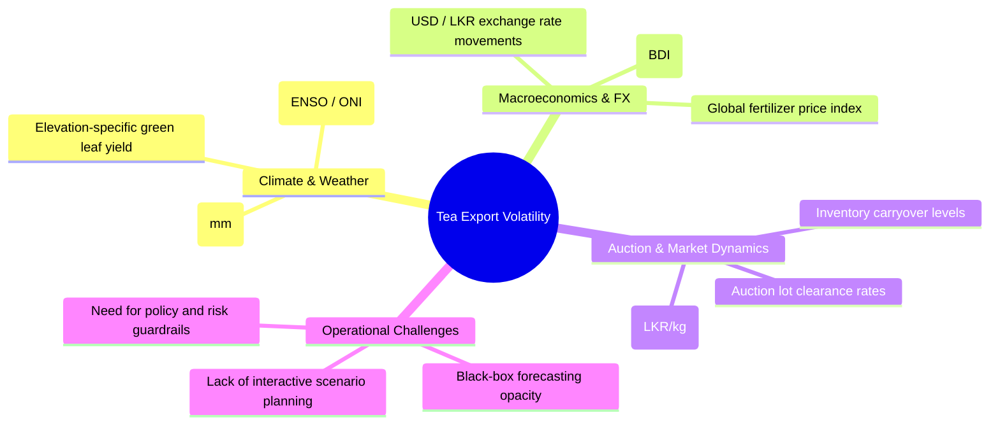
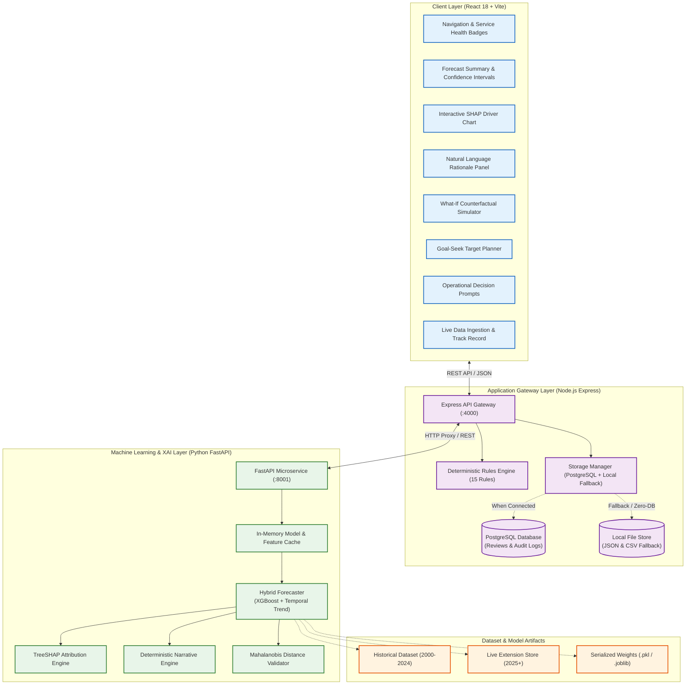
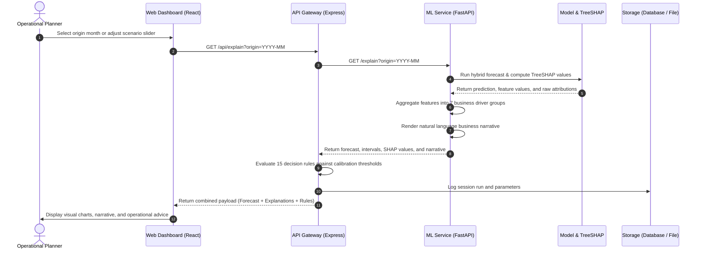
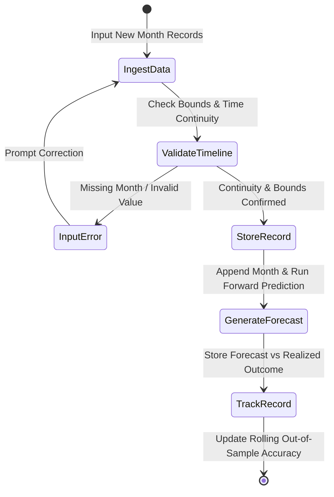
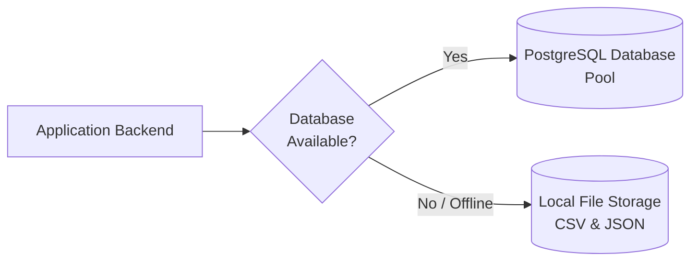
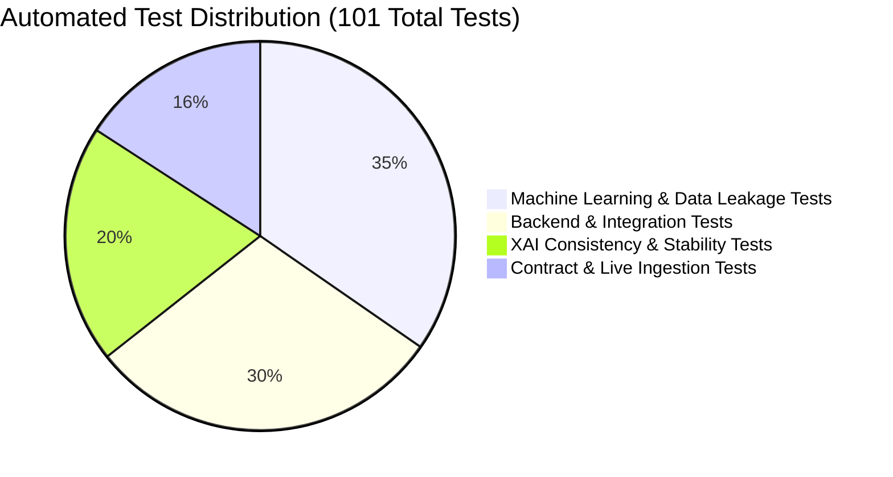

# AI-Based Decision Support System for Sri Lankan Tea Export Operations
### Explainable Artificial Intelligence (XAI) & Operational Decision Support Platform

[](https://github.com)
[](https://www.python.org/)
[](https://fastapi.tiangolo.com/)
[](https://xgboost.readthedocs.io/)
[](https://nodejs.org/)
[](https://expressjs.com/)
[](https://react.dev/)
[](https://vitejs.dev/)
[](https://www.postgresql.org/)
[](https://github.com)

---

## Project Overview

* **Application Domain:** Agricultural Economics, Predictive Forecasting & Decision Intelligence
* **Primary Scope:** Sri Lankan Tea Export Planning (*Pure Ceylon Tea*)
* **Architecture:** Decoupled 3-Tier Microservices (React Client, Express API Gateway, Python FastAPI ML Engine)
* **Core Technologies:** Gradient Boosted Trees (XGBoost), TreeSHAP Explainability, Natural Language Rationale Generation, Rule-Based Governance Engine

---

## Table of Contents

- [1. Executive Summary](#1-executive-summary)
- [2. Industry Challenge & Motivation](#2-industry-challenge--motivation)
- [3. System Architecture](#3-system-architecture)
  - [3.1 High-Level Architecture](#31-high-level-architecture)
  - [3.2 Data Flow & Processing Pipeline](#32-data-flow--processing-pipeline)
  - [3.3 Mathematical Formulation & Attribution Identity](#33-mathematical-formulation--attribution-identity)
- [4. Core Platform Capabilities](#4-core-platform-capabilities)
  - [4.1 Explainable AI with TreeSHAP](#41-explainable-ai-with-treeshap)
  - [4.2 Natural Language Business Rationale](#42-natural-language-business-rationale)
  - [4.3 Counterfactual What-If Scenario Simulator](#43-counterfactual-what-if-scenario-simulator)
  - [4.4 Target Goal-Seek Optimization](#44-target-goal-seek-optimization)
  - [4.5 Domain Decision Rules & Governance (15 Rules)](#45-domain-decision-rules--governance-15-rules)
  - [4.6 Continuous Live Operations & Tracking](#46-continuous-live-operations--tracking)
  - [4.7 Dual-Mode Persistence Architecture](#47-dual-mode-persistence-architecture)
- [5. Machine Learning Benchmarks & Evaluation](#5-machine-learning-benchmarks--evaluation)
  - [5.1 Dataset Specifications & Preprocessing](#51-dataset-specifications--preprocessing)
  - [5.2 Walk-Forward Expanding Window Evaluation](#52-walk-forward-expanding-window-evaluation)
  - [5.3 Explanation Consistency & Stability](#53-explanation-consistency--stability)
- [6. Repository Directory Structure](#6-repository-directory-structure)
- [7. Installation & Quickstart](#7-installation--quickstart)
  - [7.1 Prerequisites](#71-prerequisites)
  - [7.2 Service Setup & Execution](#72-service-setup--execution)
  - [7.3 Model Retraining & Evaluation](#73-model-retraining--evaluation)
- [8. REST API Reference](#8-rest-api-reference)
  - [8.1 Machine Learning Service (FastAPI - Port 8001)](#81-machine-learning-service-fastapi---port-8001)
  - [8.2 Application Gateway Backend (Express - Port 4000)](#82-application-gateway-backend-express---port-4000)
- [9. Quality Assurance & Automated Testing](#9-quality-assurance--automated-testing)
- [10. Technical Limitations & Disclosures](#10-technical-limitations--disclosures)
- [11. License & Usage Terms](#11-license--usage-terms)

---

## 1. Executive Summary

The **AI-Based Decision Support System for Sri Lankan Tea Export Operations** is an enterprise-grade analytical platform that bridges the gap between machine learning models and real-world operational decision-making in the tea export sector.

Traditional machine learning algorithms frequently operate as opaque black boxes, delivering raw numerical predictions without explaining the underlying economic or climatic drivers. In volatile commodity markets, commercial exporters and policy planners cannot risk commitments based solely on numbers.

This platform resolves this challenge by providing:
1. **Explainable AI (TreeSHAP):** Decomposes every forecast into transparent contributions across seven business driver groups (exchange rates, auction prices, rainfall anomalies, buyer demand).
2. **Automated Business Narratives:** Translates mathematical attribution values into readable, deterministic executive summaries.
3. **Interactive What-If Simulation:** Enables planners to stress-test scenarios (e.g., currency movements or rainfall shortages) within historical safety guardrails.
4. **Target Goal-Seek Engine:** Calculates the exact operational adjustments required to achieve specific export volume targets.
5. **Operational Decision Rules:** Evaluates 15 risk triggers (unusual market conditions, wide intervals, conflicting signals) to guide export logistics and procurement.
6. **Continuous Ingestion:** Ingests live monthly data with strict continuity and bounds validation while logging historical model accuracy over time.

---

## 2. Industry Challenge & Motivation

Sri Lankan tea (*Pure Ceylon Tea*) is a vital pillar of the national economy, generating substantial foreign exchange revenue. However, export planning is vulnerable to multiple external shocks:

* **Currency Fluctuations:** Swings in the USD/LKR exchange rate directly affect international bidding power and exporter margins.
* **Weather & Climate Variations:** Monsoons, seasonal dry spells, and Oceanic Niño Index (ONI) cycles directly impact high, medium, and low-elevation harvest volumes.
* **Macroeconomic Shocks:** Fertilizer price spikes, trade route bottlenecks, and global commodity inflation create non-linear market shifts.



### The Need for Explainable AI
When an algorithm outputs a standalone prediction such as `23.4 million kg`, planners are left with critical unanswered questions:
* *Which market factors are driving this change?*
* *Is the projected growth driven by agricultural yield, currency shifts, or global demand?*
* *What is the forecast impact if shipping freight rates rise or rainfall drops?*
* *How should operations respond if market conditions have no historical precedent?*

This platform provides the tools to answer these questions with full mathematical rigor.

---

## 3. System Architecture

The platform uses a decoupled microservices architecture designed for resilience, modular development, and zero-configuration operation.

### 3.1 High-Level Architecture



---

### 3.2 Data Flow & Processing Pipeline

The following sequence diagram illustrates the coordinated workflow when generating an explained forecast or evaluating an interactive scenario:



---

### 3.3 Mathematical Formulation & Attribution Identity

The primary forecaster implements a hybrid blend combining non-linear gradient-boosted decision trees with a parametric temporal trend model:

$$\hat{y}_{t+1} = (1 - w) \cdot \hat{y}_{\text{XGB}} + w \cdot \hat{y}_{\text{temporal}}$$

Where:
* $w = 0.7$ is the fixed blend weight determined via walk-forward cross-validation.
* $\hat{y}_{\text{XGB}}$ represents the output of 100 shallow XGBoost trees (max depth 3, learning rate 0.05).
* $\hat{y}_{\text{temporal}}$ captures underlying structural trend and annual seasonality.

#### Exact TreeSHAP Reconciliation
Using the TreeSHAP algorithm, the non-linear XGBoost prediction is decomposed into additive feature contributions $\phi_i$:

$$\hat{y}_{\text{XGB}} = \phi_0 + \sum_{i=1}^{M} \phi_i$$

Substituting into the hybrid equation yields the complete attribution identity:

$$\text{Forecast} = \underbrace{(1 - w) \cdot \phi_0}_{\text{Adjusted Base Value}} + \sum_{i=1}^{M} \underbrace{(1 - w) \cdot \phi_i}_{\text{Adjusted Feature Attribution}} + \underbrace{w \cdot \hat{y}_{\text{temporal}}}_{\text{Explicit Temporal Term}}$$

This guarantees:
$$\left| \text{Forecast} - \left( (1 - w)\phi_0 + \sum_{i=1}^M (1 - w)\phi_i + w \cdot \hat{y}_{\text{temporal}} \right) \right| < 10^{-5} \text{ mn kg}$$

Every forecast is verified against this identity to ensure zero mathematical leakage.

---

## 4. Core Platform Capabilities

### 4.1 Explainable AI with TreeSHAP

Rather than presenting raw, low-level technical lag variables (e.g., `export_lag1`, `usd_lkr_pct_chg_3m`), the platform groups 17 individual features into **seven business-relevant driver categories**:

1. **Recent Export Momentum:** Trailing 3-month export performance and short-term trends.
2. **Annual Seasonality:** Calendar month patterns and seasonal crop flush cycles.
3. **USD/LKR Exchange Rate:** Currency strength, short-term percentage shifts, and volatility.
4. **Colombo Auction Prices:** National average, high-elevation, and low-elevation auction values.
5. **Rainfall & Weather Anomalies:** Key plantation precipitation levels and deviation from historical norms.
6. **Oceanic Niño Index (ONI):** Sea surface temperature anomalies indicating El Niño / La Niña events.
7. **Global Buyer Demand Index (BDI):** Trade partner GDP-weighted tea import demand proxy.

* **Waterfall Visualizations:** Displays positive drivers (increasing exports) and negative drivers (suppressing volume) in intuitive horizontal bar charts.
* **Global vs. Local Analysis:** Supports inspecting both overall model behavior across decades and month-specific attributions.

---

### 4.2 Natural Language Business Rationale

To support executive decision-making, the system includes a deterministic template engine that translates mathematical attributions into concise English narratives.

#### Example Output:
> *"The forecast for **April 2024** projects **22.84 million kg** (80% confidence interval: 20.44 to 25.57 mn kg), reflecting a +4.2% increase over the trailing 3-month average. The projected increase is primarily driven by favorable **USD/LKR exchange rate competitiveness** (+0.42 mn kg) and strong **seasonal harvest flush** (+0.31 mn kg), offset by minor headwinds from **below-average Western elevation rainfall** (-0.18 mn kg). All model components agree within normal validation bounds."*

---

### 4.3 Counterfactual What-If Scenario Simulator

Planners can simulate alternative market scenarios using interactive sliders:

* **Input Safety Guardrails:** Sliders are bounded by historical 5th–95th percentile ranges to prevent impossible combinations. Values outside physical limits are rejected with HTTP 422.
* **Dependent Feature Recalculation:** Adjusting a primary variable (e.g., `usd_lkr`) automatically recomputes all derived features (percentage changes, moving averages, and dollar-converted auction values) before re-running inference.
* **Baseline Preservation:** Scenarios run in isolated memory spaces, preserving original baseline forecasts.

---

### 4.4 Target Goal-Seek Optimization

Planners can perform reverse scenario analysis by defining a target volume:
> *"What USD/LKR exchange rate or rainfall level is needed to reach an export volume of 25.0 million kg next month?"*

The Goal-Seek engine runs a bounded grid search across the selected driver's valid historical domain, updates all dependent features, and returns:
* The closest achievable volume
* The required driver value
* Percentage variance from baseline
* An instant "Apply to Simulator" button

---

### 4.5 Domain Decision Rules & Governance (15 Rules)

The system continuously evaluates 15 deterministic business rules grouped into five functional categories:

| Rule ID | Category | Severity | Trigger Threshold | Operational Advisory Action |
|---|---|---|---|---|
| `FORECAST_ABOVE_RECENT` | Direction | **Review** | Forecast > 80th percentile of 3-month changes | Verify vessel booking quotas and inventory availability |
| `FORECAST_BELOW_RECENT` | Direction | **Review** | Forecast < 20th percentile of 3-month changes | Review warehouse storage plans and forward orders |
| `ABOVE_LAST_YEAR` | Direction | **Info** | YoY growth > 80th percentile of historical changes | Confirm buyer contracts reflect significant expansion |
| `BELOW_LAST_YEAR` | Direction | **Info** | YoY drop > 20th percentile of historical changes | Investigate destination market trade barriers |
| `WIDE_INTERVAL` | Uncertainty | **Caution** | 80% interval width > 25% of point forecast | Avoid committing fixed-volume penalty agreements |
| `BRANCH_DISAGREEMENT` | Uncertainty | **Caution** | \|XGBoost - Temporal\| > 90th percentile gap | Dual models diverge; apply qualitative market judgment |
| `DRIVER_CONCENTRATION` | Explanation | **Review** | Single driver accounts for ≥60% of total movement | Verify driver assumptions (sensitive to single variable) |
| `MIXED_SIGNALS` | Explanation | **Review** | Both positive & negative drivers exceed 0.25 mn kg | Market drivers conflict; monitor auction clearance rates |
| `DATA_QUALITY` | Data Quality | **Caution** | Inputs contain synthetic series or reconciliation issue | Audit input data sources before finalizing plans |
| `IN_SAMPLE_MONTH` | Data Quality | **Info** | Month falls within training set (≤2021) | In-sample performance is optimistic; use held-out test data |
| `UNUSUAL_CONDITIONS` | Data Quality | **Caution** | Mahalanobis distance $D^2 > 97.5\text{th}$ percentile | Market condition combination is historically rare |
| `SCENARIO_OUTSIDE_USUAL` | Scenario | **Caution** | Input value lies outside 5th–95th percentile | Counterfactual extrapolation warning |
| `SCENARIO_UNUSUAL_COMBO` | Scenario | **Caution** | Scenario combination exceeds $D^2_{97.5}$ | Independent driver changes create rare market state |
| `SCENARIO_MATERIAL` | Scenario | **Review** | Scenario shifts forecast by ≥2.0% | Material operational change; confirm assumptions |
| `SCENARIO_NEGLIGIBLE` | Scenario | **Info** | Scenario shifts forecast by <0.5% | Model exhibits momentum dominance; change is muted |

* **Expert Governance:** Rules remain marked as `DRAFT` upon initial deployment. An integrated review modal allows industry specialists to submit structured assessments (`agree`, `partly`, `disagree`). Rules transition to `REVIEWED` status once consensus is logged.

---

### 4.6 Continuous Live Operations & Tracking

The platform supports ongoing operations for current and future months (2025+):



* **Timeline Continuity:** Time-series lag calculations require unbroken historical sequences. The ingestion module enforces sequential consistency (e.g., month `2025-02` cannot be added unless `2025-01` is present).
* **Track-Record Monitoring:** Compares forward forecasts against realized out-of-sample actuals over time, computing a continuous Mean Absolute Error (MAE).

---

### 4.7 Dual-Mode Persistence Architecture

The application includes an automated persistence fallback to ensure seamless local operation:



* When PostgreSQL is running, review audits and session runs are stored in relational tables.
* If PostgreSQL is not installed or disconnected, the system transparently logs records to local CSV and JSON files without errors or service interruption.

---

## 5. Machine Learning Benchmarks & Evaluation

### 5.1 Dataset Specifications & Preprocessing

* **Data Scope:** 300 consecutive monthly records from January 2000 to December 2024.
* **Target Variable:** Total Sri Lankan tea exports in **million kilograms (mn kg)**, one month ahead ($t+1$).
* **Data Splits (Time-Series Partitioning):**
  * **Training Period:** 2000-01 to 2018-12 (228 months)
  * **Validation Period:** 2019-01 to 2021-12 (36 months)
  * **Held-Out Test Period:** 2022-01 to 2024-12 (35 months)

#### Data Cleaning Operations
* Standardized historical unit variations between kilograms and million kilograms.
* Deduplicated overlapping calendar records.
* Corrected typographical anomalies in legacy auction totals.
* Handled meteorological sentinels (`-999`) using seasonal interpolation.
* Verified that feature engineering introduces zero future lookahead bias.

---

### 5.2 Walk-Forward Expanding Window Evaluation

Evaluated using expanding-window walk-forward validation on the held-out test set (2022-01 to 2024-12):

| Model | MAE (mn kg) | RMSE (mn kg) | MAPE (%) | Bias (mn kg) | Theil's U vs. Persistence |
|---|---|---|---|---|---|
| **Hybrid Model Blend ($w=0.7$)** | **1.828** | **2.300** | **9.69%** | **+0.65** | **1.005** |
| XGBoost Component Alone | 1.754 | 2.187 | 9.30% | +0.78 | 0.956 |
| Temporal Component Alone | 1.932 | 2.467 | 10.24% | +0.60 | 1.078 |
| Seasonal Naive Benchmark | 2.603 | 3.365 | 13.87% | +1.21 | 1.470 |
| Persistence Benchmark | 1.813 | 2.289 | 9.77% | +0.14 | 1.000 |

* **Interval Reliability:** An empirical 80% prediction interval covers **74%** of evaluated held-out test months during the volatile 2022–2024 macroeconomic crisis period.

---

### 5.3 Explanation Consistency & Stability

* **Exact Additivity:** Maximum observed reconciliation error of **$3.91 \times 10^{-6}$ mn kg** across all test periods (well within the $0.001$ threshold).
* **Deterministic Stability:** 100% agreement on top-ranked drivers and directional signs under input perturbation tests ($\pm 0.5\%$).
* **Heuristic Alignment:** 97.2% agreement with established domain directional rules.

---

## 6. Repository Directory Structure

```text
├── frontend/                          # React 18 + Vite Web Application
│   ├── src/
│   │   ├── components/
│   │   │   ├── AddLiveMonthModal.jsx  # Live month ingestion interface
│   │   │   ├── DecisionPrompts.jsx    # Rule advisory cards & evidence views
│   │   │   ├── DriverChart.jsx        # Interactive SHAP attribution bar chart
│   │   │   ├── ForecastSummary.jsx    # Primary forecast card & interval metrics
│   │   │   ├── GlobalImportance.jsx   # Historical feature importance view
│   │   │   ├── GoalSeek.jsx           # Reverse target volume calculator
│   │   │   ├── Limitations.jsx        # Platform disclosures & bounds guide
│   │   │   ├── Rationale.jsx          # Natural language narrative summary
│   │   │   ├── RulesReviewModal.jsx   # Expert consensus & governance modal
│   │   │   ├── ScenarioComparison.jsx # Counterfactual scenario comparison
│   │   │   ├── Sidebar.jsx            # Month selector & service health status
│   │   │   └── TrackRecordModal.jsx   # Out-of-sample forecast tracker
│   │   ├── App.jsx                    # Root state manager & dashboard layout
│   │   ├── api.js                     # Unified backend REST client
│   │   ├── format.js                  # Formatting utilities (units, currency)
│   │   └── styles.css                 # Custom CSS design system
│   ├── package.json
│   └── vite.config.js
│
├── backend/                           # Node.js Express API Gateway
│   ├── database/
│   │   └── schema.sql                 # PostgreSQL relational schema
│   ├── scripts/
│   │   └── initDb.js                  # Database connection tester & initializer
│   ├── src/
│   │   ├── db/
│   │   │   └── repository.js          # PostgreSQL access layer with fallback
│   │   ├── routes/
│   │   │   ├── rules.js               # Decision rules & review endpoints
│   │   │   └── study.js               # Research study logging routes
│   │   ├── rules/
│   │   │   ├── catalogue.js           # 15 domain decision rule definitions
│   │   │   └── engine.js              # Deterministic rule evaluation logic
│   │   ├── app.js                     # Express middleware & route bindings
│   │   ├── liveForecastStore.js       # Local JSON fallback store
│   │   ├── mlClient.js                # HTTP client for ML microservice
│   │   └── server.js                  # Server listener on port 4000
│   └── tests/
│       └── test_live_api.test.js      # Backend integration test suite
│
├── ml_service/                        # Python FastAPI Machine Learning Microservice
│   ├── app/
│   │   ├── templates/
│   │   │   ├── forecast_rationale.txt.j2 # Jinja2 baseline narrative template
│   │   │   └── scenario_rationale.txt.j2 # Jinja2 counterfactual template
│   │   ├── calibration.py             # Empirical prediction intervals
│   │   ├── explain.py                 # TreeSHAP attribution & additivity verification
│   │   ├── main.py                    # FastAPI route definitions (port 8001)
│   │   ├── rationale.py               # Narrative generation module
│   │   ├── service.py                 # In-memory model caching & inference
│   │   └── settings.py                # Service configuration & driver definitions
│   └── requirements.txt
│
└── ml_light_model/                    # Standalone Model Pipeline & Evaluation
    ├── data/
    │   ├── raw/
    │   │   └── M1_combined_monthly_raw.csv # Historical monthly dataset (2000-2024)
    │   ├── processed/                 # Cleaned dataset & feature matrices
    │   └── live/                      # Live extension records (2025+)
    ├── models/
    │   ├── m1lite_v0.2.0.joblib       # Serialized XGBoost model artifacts
    │   └── m1lite_v0.2.0.pkl          # Pickled hybrid forecaster object
    ├── notebooks/
    │   └── M1_lite_training.ipynb     # Interactive model training notebook
    ├── reports/
    │   ├── dataset_qa.md              # Dataset quality assurance report
    │   ├── explanation_quality.json   # SHAP stability metrics
    │   └── m1lite_evaluation.md       # Walk-forward benchmark evaluation
    ├── tea_m3/
    │   ├── forecasting/
    │   │   ├── interface.py           # Forecaster abstract base class
    │   │   └── m1lite.py              # XGBoost + Linear trend implementation
    │   ├── config.py                  # Driver configurations & split parameters
    │   ├── data_prep.py               # Data ingestion & cleaning pipeline
    │   ├── features.py                # Lag feature engineering
    │   └── live_data.py               # Live data validation routines
    └── tests/                         # Unit tests (data leakage, SHAP additivity)
```

---

## 7. Installation & Quickstart

### 7.1 Prerequisites
* **Python 3.11+**
* **Node.js 20+ / 22+ LTS**
* **Git**
* *(Optional)* **PostgreSQL 13+** (The backend automatically runs in local storage mode if PostgreSQL is not installed)

---

### 7.2 Service Setup & Execution

Open three separate terminal windows to run each service:

#### Terminal 1: Machine Learning Service (FastAPI)
```bash
cd ml_service

# Create and activate a virtual environment
python -m venv .venv

# On Windows:
.venv\Scripts\activate
# On macOS / Linux:
source .venv/bin/activate

# Install dependencies and start the service
pip install -r requirements.txt
pip install -r ../ml_light_model/requirements.txt
uvicorn app.main:app --host 127.0.0.1 --port 8001 --reload
```
*The Machine Learning Service will run at `http://localhost:8001`.*

#### Terminal 2: Application Gateway Backend (Express)
```bash
cd backend

# Install dependencies and start server
npm install
npm start
```
*The Backend API Gateway will run at `http://localhost:4000`.*

#### Terminal 3: Web Dashboard Frontend (React + Vite)
```bash
cd frontend

# Install dependencies and start development server
npm install
npm run dev
```
*Open `http://localhost:5174` in your web browser to access the dashboard.*

---

### 7.3 Model Retraining & Evaluation

To inspect or retrain the forecasting model independently:

```bash
cd ml_light_model
pip install -r requirements.txt

# Run model test suite
python -m pytest tests/

# Evaluate explanation stability and additivity metrics
python scripts/evaluate_explanations.py
```

---

## 8. REST API Reference

### 8.1 Machine Learning Service (FastAPI - Port 8001)

| Method | Endpoint | Description |
|---|---|---|
| `GET` | `/health` | Returns service health, model identifier (`v0.2.0`), and live month count |
| `GET` | `/origins` | Lists available origin months (`live`, `held_out`, `in_sample`) |
| `GET` | `/explain?origin=YYYY-MM` | Computes forecast, exact TreeSHAP values, driver groups, and rationale text |
| `POST` | `/scenario` | Evaluates driver overrides and computes variance from baseline |
| `POST` | `/goal-seek` | Searches driver domain to identify setting matching target volume |
| `GET` | `/live/months` | Returns all ingested live records |
| `POST` | `/live/months` | Ingests a new month record with strict bounds and continuity checks |
| `DELETE` | `/live/months/latest` | Removes the latest live month |

#### Sample Scenario Request Payload (`POST /scenario`):
```json
{
  "origin": "2024-03",
  "overrides": {
    "usd_lkr": 335.0,
    "rain_mm": 185.0
  }
}
```

---

### 8.2 Application Gateway Backend (Express - Port 4000)

| Method | Endpoint | Description |
|---|---|---|
| `GET` | `/api/origins` | Returns available origin months grouped by dataset split |
| `GET` | `/api/explain?origin=YYYY-MM` | Core endpoint: aggregated ML predictions and 15-rule evaluation |
| `GET` | `/api/explain?origin=YYYY-MM&interactive=1&<driver>=<val>` | Evaluates counterfactual scenario with updated rule checks |
| `POST` | `/api/goal-seek` | Reverse scenario search endpoint |
| `GET` | `/api/rules` | Retrieves all 15 decision rules, current review counts, and status |
| `POST` | `/api/rules/:ruleId/reviews` | Submits domain expert review (`agree`, `partly`, `disagree`) |
| `GET` | `/api/live/track-record` | Returns historical forward predictions versus realized actuals |
| `POST` | `/api/live/months` | Secured ingestion endpoint for live monthly records |

---

## 9. Quality Assurance & Automated Testing

The codebase includes automated test suites covering data integrity, algorithmic constraints, API contracts, and user interface builds:



### Running Test Suites:

```bash
# 1. Run Python unit and leakage tests
python -m pytest ml_light_model/tests/

# 2. Run Backend API integration tests
cd backend && node --test tests/test_live_api.test.js

# 3. Verify Frontend production build
cd frontend && npm run build
```

---

## 10. Technical Limitations & Disclosures

1. **Step-Function Sensitivity:** Gradient-boosted decision trees partition feature space using orthogonal splits. Consequently, minor adjustments to continuous sliders may show zero change until a split threshold is crossed. The UI explicitly alerts users when model sensitivity is negligible.
2. **Pre-2013 Currency Series:** Historical USD/LKR exchange rates prior to 2013 include interpolated series in the raw data. This is flagged by the Data Quality rule family (`DATA_QUALITY`).
3. **Attribution vs. Causality:** SHAP values represent statistical feature contributions within the model rather than strict macroeconomic causality. Prompts are intentionally structured as advisory recommendations (*"Consider reviewing..."*) rather than automated directives.

---

## 11. License & Usage Terms

This project is developed for research, educational, and operational decision-support exploration. The software is provided "as is" without warranties of any kind. Forecasts and simulations should be used alongside domain expertise and should not serve as the sole basis for commercial or financial commitments.

---

<p align="center">
  <b>AI-Based Decision Support System for Sri Lankan Tea Export Operations</b><br>
  <i>Explainable, Transparent, and Auditable Artificial Intelligence for Global Trade.</i>
</p>
